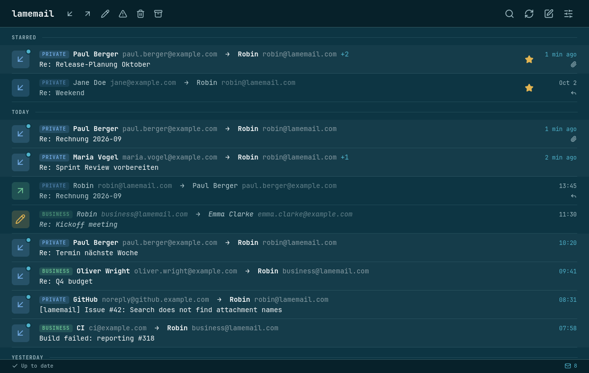
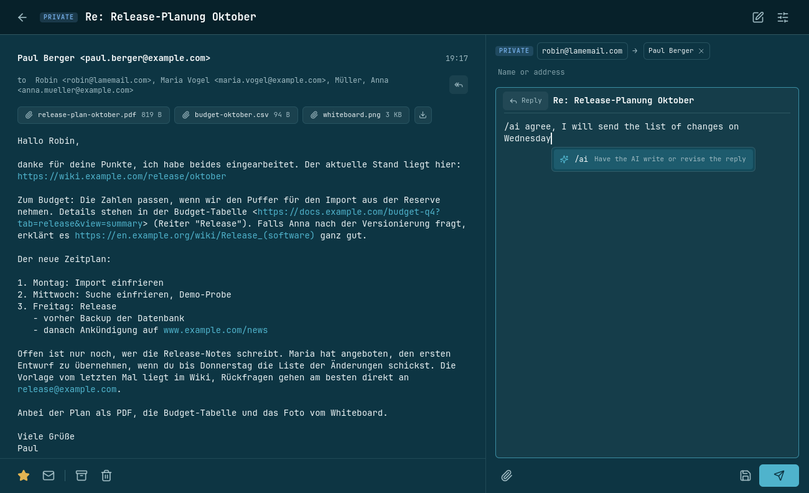
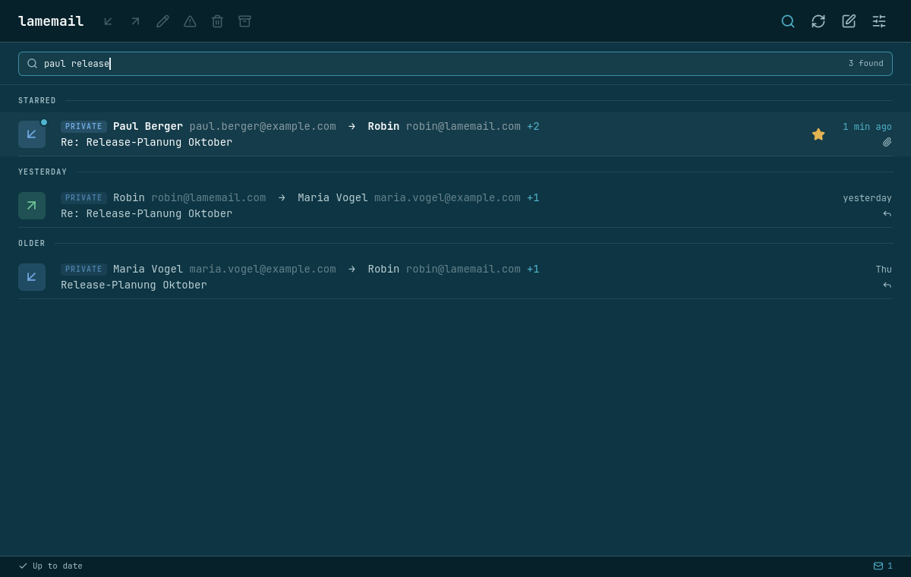
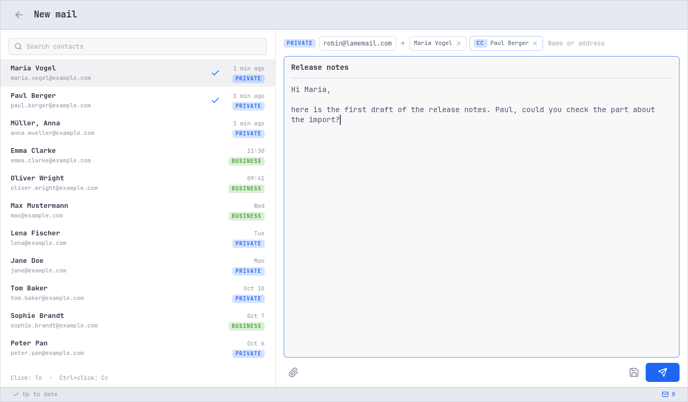
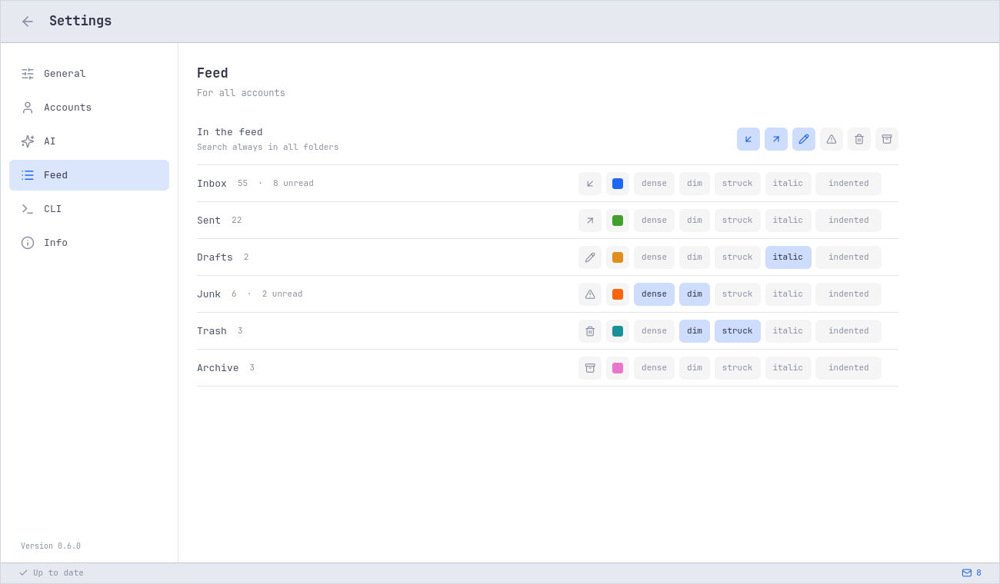
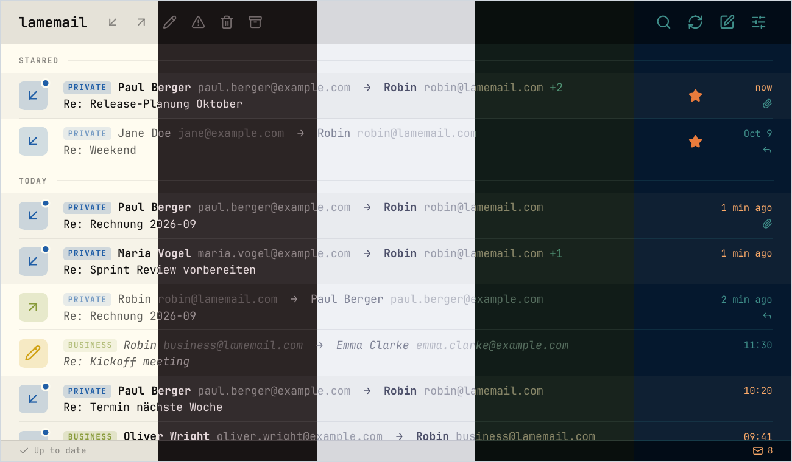

<h1 align="center">lamemail</h1>

<p align="center">
  <strong>The mail client built for working with AI.</strong><br>
  Plain text · one feed · blazing fast
</p>

<p align="center">
  
</p>

## Features

- **A CLI for everything.** Sync, search, send, archive: every action is
  a `lamemail` command, each with JSON output.
- **Mail as plain files.** One JSON text file per message. `grep`, `jq`
  and your scripts just work.
- **One feed.** All accounts in a single list, newest on top. No folder
  tree, no three panes.
- **Instant search.** 20,000 messages in about a tenth of a second,
  without a database or an index.
- **Slash commands.** Type `/` while you write: `/quote`, `/signature`,
  `/attach`, `/date` and `/ai`.
- **AI writing.** `/ai` and what you want to say, in a reply or a new
  mail. The model drafts it from the message, your history with these
  people and your own notes.
- **Your model.** Ollama on your machine, or any program you like. Off
  until you switch it on.
- **Open to agents.** An MCP server lets AI agents read mail and write
  drafts. Sending stays with you.
- **Omarchy theme.** Follows your Omarchy theme as you switch it, with
  its own light and dark themes everywhere else.
- **Reply first.** Open a message and the reply box is ready.
- **Undo.** Five seconds to take back a send, a move or a delete.
- **Works offline.** Changes are recorded like git commits and pushed
  when you are back online.
- **Live inbox.** New mail shows up the moment it arrives, with a desktop
  notification.
- **No HTML.** Every mail is plain text. Tracking pixels and remote
  images never load, and links show where they lead.
- **Keyboard driven.** Actions sit on `Ctrl` shortcuts, never on a single
  key, so a stray keypress never archives anything.
- **Private.** Passwords live in the system keyring. Nothing goes to an
  AI unless you ask.
- **Native.** Rust and Qt 6. No web view, no Electron.
- **English and German.**

## The command line

By default your mail lives in `~/.lamemail`. Every tool that understands
text understands your mail:

```console
$ cd ~/.lamemail
$ lamemail list --search "paul release"
  2026-10-10 19:17  private     Paul Berger               Re: Release-Planung Oktober
  2026-10-09 18:30  private     Robin                     Re: Release-Planung Oktober
  2026-10-08 10:05  private     Maria Vogel               Release-Planung Oktober

$ grep -rl "lake hike" .
./private/sent/2026-10-01_2105-re-weekend-120.json
./private/sent/2026-10-02_0814-re-weekend-122.json
./private/inbox/2026-10-01_1920-weekend-119.json
./private/inbox/2026-10-02_0750-re-weekend-121.json

$ jq '{from: .from[0].name, subject, body}' private/inbox/2026-10-01_1920-weekend-119.json
{
  "from": "Jane Doe",
  "subject": "Weekend",
  "body": "Hey Robin,\n\nare you around this weekend? We could do the lake hike if the weather holds.\n\nJane\n\n-- \nSent from my phone\n"
}
```

Changes work like git commits. `send`, `move`, `flag` and `delete` are
recorded locally, instantly and even offline. `push` delivers them to
the server:

```console
$ echo "Saturday at nine?" | lamemail send --reply private/inbox/2026-10-01_1920-weekend-119.json
$ lamemail move private/inbox/2026-10-01_1920-weekend-119.json archive
$ lamemail push
```

The [CLI README](lamemail-cli/README.md) lists every command,
[`FORMAT.md`](lamemail-cli/FORMAT.md) documents the file format and the
JSON output.

## The UI

<table>
  <tr>
    <td width="50%" valign="top">
      <br>
      <sub>The reply sits beside the mail; <code>/ai</code> and an instruction let the AI write it.</sub>
    </td>
    <td width="50%" valign="top">
      <br>
      <sub>Search covers all synchronized mail, whatever the feed shows.</sub>
    </td>
  </tr>
  <tr>
    <td width="50%" valign="top">
      <br>
      <sub>New mail starts from your contacts: a click adds To, <code>Ctrl</code>+click adds Cc.</sub>
    </td>
    <td width="50%" valign="top">
      <br>
      <sub>Each kind of folder has its own icon, colour and look in the feed.</sub>
    </td>
  </tr>
</table>

<p>
  <br>
  <sub>lamemail follows your Omarchy theme live: Flexoki Light, Ristretto, Catppuccin Latte, Osaka Jade and Retro-82.</sub>
</p>

| Key | |
|---|---|
| `Enter`, `Esc` | open a message, go back |
| `/` | search |
| `Ctrl+N` | new message |
| `Ctrl+Enter` | send |
| `Ctrl+S` | save the draft to the server |
| `Ctrl+E` | archive, or move back to the inbox |
| `Ctrl+Delete` | move to trash, in the trash delete for good |
| `Ctrl+U`, `Ctrl+D` | mark read or unread, star |
| `Ctrl+Z` | undo, while the toast is counting down |
| `Ctrl+R` | sync now |
| `Ctrl+,` | settings |
| `Ctrl+Q` | quit |

The [UI README](lamemail-ui/README.md) says how to build it and where it
keeps its files.

## The AI

You decide which model answers. Until you pick one, the AI is off:

```sh
lamemail ai set ollama gemma4:12b         # a local model via Ollama
lamemail ai set custom 'llm -m mistral'   # any program that reads a prompt on stdin and prints text
```

- **Context.** Give an account a folder of text files, a price list or a
  short profile, and the model uses them when it writes.
- **Local.** With a local model your mail never leaves your computer.
- **No tools.** lamemail runs the model without tools, so a message that
  says "run this command" has nothing to run it with.

Agents connect through the Model Context Protocol. Register `lamemail
mcp` as a server with your agent:

```json
{"mcpServers": {"lamemail": {"command": "lamemail", "args": ["mcp"]}}}
```

## Status

lamemail is young and runs on Linux only. Sign-in is by password over
TLS, for both IMAP and SMTP. Gmail requires an app password. OAuth2 is
not supported yet, so accounts that insist on it won't work.

## Install

All three ways need a Secret Service keyring with `secret-tool` (package
`libsecret`), which keeps the passwords.

### Install script

On any x86_64 Linux with Qt 6.11 or newer:

```sh
curl -fsSL https://raw.githubusercontent.com/robcpc464/lamemail/master/install.sh | sh
```

It puts `lamemail` and `lamemail-ui` into `~/.local/bin` and adds the menu
entry and icon. Run the same line again to update, or end it with
`sh -s -- --uninstall` to remove lamemail. With an older Qt the command
line still works, and the script says what is missing.

### AppImage

For distributions with an older Qt, such as Ubuntu, there is an AppImage
that brings its own Qt. Started as it is, it is the UI:

```sh
curl -fLO https://github.com/robcpc464/lamemail/releases/latest/download/lamemail-x86_64.AppImage
chmod +x lamemail-x86_64.AppImage
./lamemail-x86_64.AppImage
```

The command line is the same image, called as `lamemail`:

```sh
ln -s "$PWD/lamemail-x86_64.AppImage" ~/.local/bin/lamemail
lamemail --help
```

The link points to where the image lies, so set it again after moving the
image.

### From source

You'll need Qt 6.9 or newer (on Arch: `qt6-base qt6-declarative
qt6-wayland qt6-svg`), `base-devel` and `curl`.

```sh
git clone https://github.com/robcpc464/lamemail
cd lamemail
lamemail-cli/setup    # once: installs Rust inside the project folder, nothing system-wide
./dev install         # builds everything into ~/.local/bin and adds the menu entry and icon
```

`./dev uninstall` removes it again.

## Getting started

```sh
lamemail init
lamemail-ui
```

With the AppImage, the image itself is `lamemail-ui`. Open the settings
(`Ctrl+,`) and add an account: a short name, your IMAP server, login,
password and SMTP server. The first sync starts right away. Prefer the
terminal?

```sh
lamemail account add private --host imap.example.com --user me@example.com --smtp-host smtp.example.com
lamemail sync
lamemail list
```

## Under the hood

Two projects, one repository, very few dependencies:

- [`lamemail-cli`](lamemail-cli/README.md) is written in Rust. IMAP, MIME
  and HTML are untrusted input, which is exactly where memory safety
  matters.
- [`lamemail-ui`](lamemail-ui/README.md) is C++ and Qt 6 with a QML
  interface. Fully native: no web view, nothing but Qt.

## Why "lamemail"?

Because email is lame. Reading it is lame, writing it is lame, the
clients are lame, and the protocol underneath is from 1986 and feels
like it. lamemail does not pretend otherwise: it turns your mail into
a folder of text files and lets an AI do the lame parts.

Also, I am bad at naming things.

## Contributing

lamemail does not accept pull requests. Bug reports and ideas are very
welcome as issues, see [`CONTRIBUTING.md`](CONTRIBUTING.md). For security
problems, see [`SECURITY.md`](SECURITY.md).

The commit log is kept by the Librarian. Ook.

## License

lamemail is free software, licensed under the GNU General Public License,
version 3 or later ([`LICENSE`](LICENSE)). Icons by
[Lucide](https://lucide.dev) ([`LICENSE-lucide`](lamemail-ui/LICENSE-lucide)).

lamemail is distributed in the hope that it will be useful, but WITHOUT
ANY WARRANTY; without even the implied warranty of MERCHANTABILITY or
FITNESS FOR A PARTICULAR PURPOSE. See the GNU General Public License for
more details.
